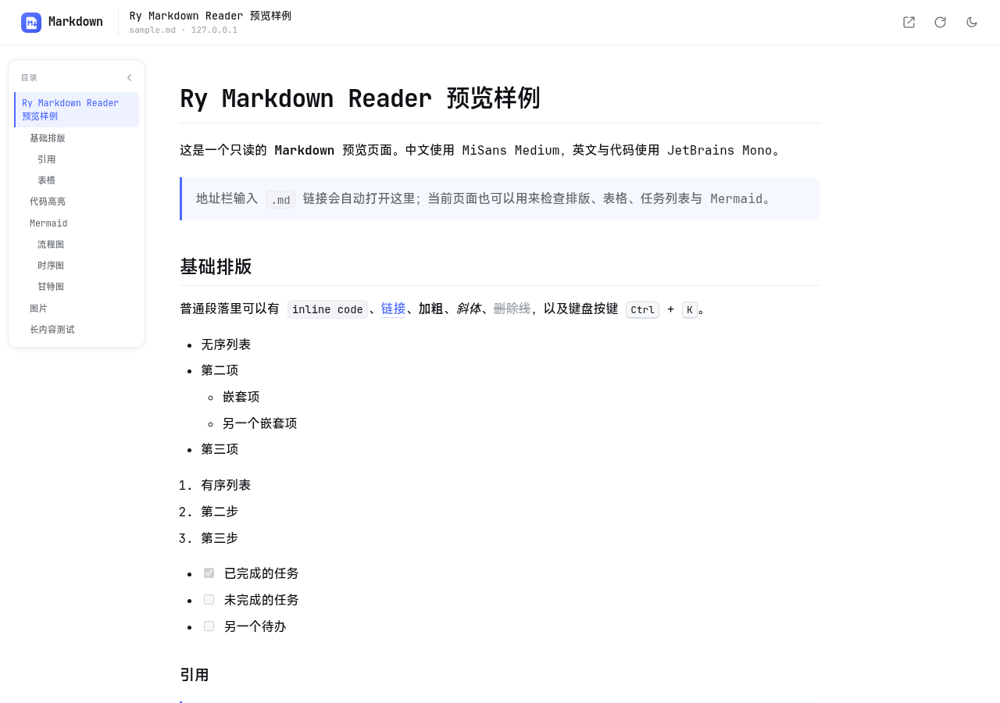
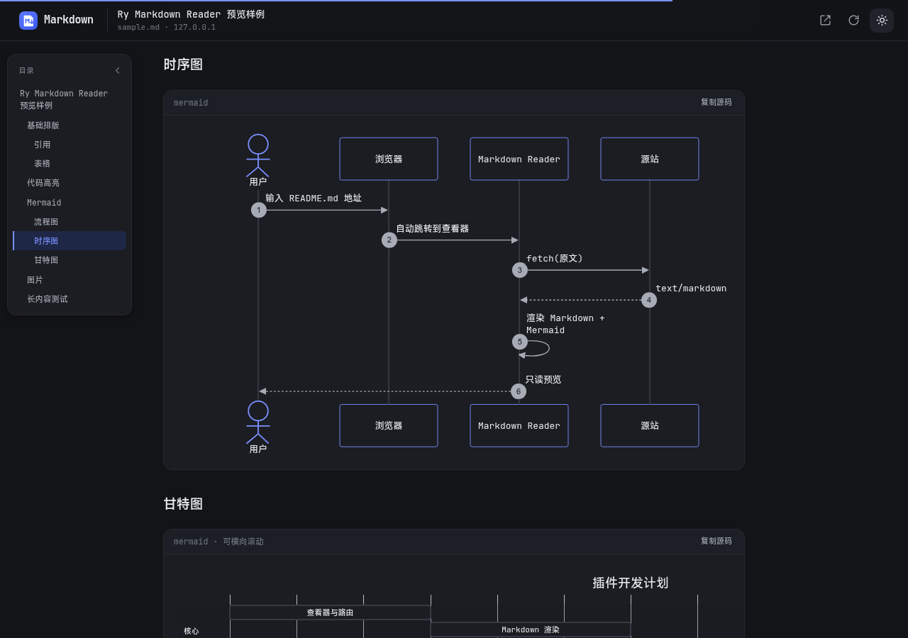
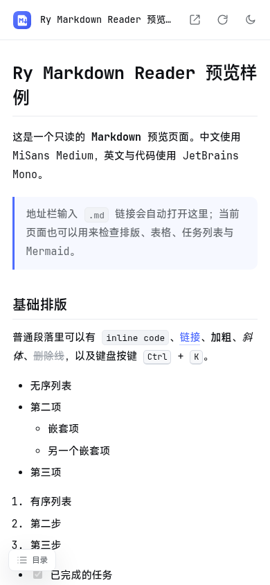

# Ry Markdown Reader

一个只读的 Chromium Markdown 阅读器扩展：在地址栏打开本地或远程 `.md` 链接就会自动渲染，不包含文件管理、编辑器或上传功能。

## 预览

浅色主题：



深色主题与 Mermaid：



移动端：

<p align="center"></p>

## 功能

- **地址栏直达**：浏览器导航到本地 `/home/.../README.md`（或 `file:///...`）以及 `https://.../README.md` 时，自动交给内置查看器渲染。
- **本地 + 远程**：本地文件可直接读路径；远程链接通过扩展 host 权限读取，不要求源站 CORS。
- **只读预览**：不修改源文件，没有编辑器、文件列表、拖拽上传。
- **Mermaid**：` ```mermaid ` 代码块渲染为 SVG 图表，支持 flowchart、sequence、gantt 等。
- **代码高亮**：highlight.js，内置常用语言。
- **Markdown 全量排版**：GFM 表格、任务列表、引用、图片、相对链接解析。
- **悬浮目录**：左侧自动生成章节目录，滚动时高亮当前章节，点击直接跳转，可一键收起。
- **图片放大预览**：点击正文图片打开全屏预览，支持滚轮 / 按钮缩放、拖拽平移、双击切换、`Esc` 关闭，并可打开原图。
- **明暗主题**：仅浅色 / 深色两套，右上角切换并记住选择。
- **字体**：中文 MiSans Medium，英文与代码 JetBrains Mono（全部本地打包，不请求字体 CDN）。
- **GitHub / GitLab**：`github.com/.../blob/...README.md` 和 GitLab 的 `/-/blob/` 页面会尽量自动转换为 Raw 内容。
- **安全**：marked 输出统一经过 DOMPurify；Mermaid 使用 `securityLevel: 'strict'`。
- **阅读进度**：顶部细进度条，标题自动生成锚点。

## 安装

1. 打开 Chrome / Edge 的扩展管理页：
   - Chrome：`chrome://extensions`
   - Edge：`edge://extensions`
2. 打开右上角「开发者模式」。
3. 点击「加载已解压的扩展程序」，选择本目录 `ry-md-reader/`。
4. 在扩展详情页确认开启 **「允许访问文件网址」**（本地 Markdown 需要；部分 Chrome 加载已解压扩展时会默认开启）。
5. 安装后会自动打开一次查看器首页。

## 使用

### 地址栏

直接在浏览器地址栏输入 Markdown 地址即可，例如：

```text
/home/chenmingjun/project/pos-ng/docs/plans/pos-printing/printer-device-management/README.md
```

或：

```text
file:///home/chenmingjun/project/pos-ng/docs/plans/pos-printing/printer-device-management/README.md
```

也支持远程地址：

```text
https://raw.githubusercontent.com/markedjs/marked/master/README.md
```

扩展会自动跳转到查看器并渲染。若 Chrome 把无 `file://` 的路径当成搜索词，可以加前缀 `file://`，或点击扩展图标把路径粘贴到首页输入框。

页面右上角可以：

- 查看原文（在新标签页打开 Raw 内容）
- 重新加载
- 切换明暗主题

### 工具栏

点击扩展图标会打开查看器首页。首页可以粘贴 `https://.../README.md` 或 `/home/.../README.md` 后打开；这不是文件管理，只是地址输入框。

### 目录

文档中有两个以上标题时会自动生成目录：

- 宽屏（≥1280px）：左侧悬浮显示，滚动时高亮当前章节，点击跳转
- 点击目录右上角的收起按钮可折叠，折叠后通过左侧「目录」按钮重新展开
- 窄屏：通过左下角「目录」按钮打开抽屉，点击遮罩或标题跳转后自动关闭

### 跳过自动渲染

如果希望在浏览器中直接查看 `.md` 的原始文本，在地址末尾加上 `#ry-raw`：

```text
https://example.com/README.md#ry-raw
```

查看器右上角的「查看原文」按钮也会自动加上这个标记。

### 支持范围

- 本地绝对路径：`/home/.../README.md`、`file:///home/.../README.md`、Windows 路径 `C:\docs\README.md`
- `http://` 与 `https://`
- 路径以 `.md`、`.markdown`、`.mdown`、`.mkd` 结尾（大小写不敏感）
- 需要开启扩展的「允许访问文件网址」权限才能读取本地文件
- 仅支持 Chromium 内核浏览器（Chrome / Edge 等），Manifest V3

## 字体

| 用途 | 字体 | 说明 |
| --- | --- | --- |
| 中文正文 | MiSans Medium | 标题使用同家族 Demibold |
| 英文正文、代码 | JetBrains Mono | Regular / Medium / Bold |

字体全部位于 `fonts/`，通过 CSS `@font-face` 从扩展本地加载，不走网络。字体许可见 [`THIRD_PARTY_NOTICES.md`](THIRD_PARTY_NOTICES.md) 与 [`LICENSES/`](LICENSES/)。

## 配色

色彩 token 参考 [`sapgir`](https://github.com/chenmingjun2/sapgir)：

| Token | 浅色 | 深色 |
| --- | --- | --- |
| 品牌色 | `#4d6bfe` | `#7b8fff` |
| 背景 | `#ffffff` | `#131417` |
| 正文 | `#0f1115` | `#e7e9ee` |
| 次要文字 | `#61666b` | `#a6abb5` |
| 边框 | `#e9ebef` | `#262931` |
| 代码背景 | `#f7f8fa` | `#17191e` |

## 本地调试

查看器不依赖 `chrome.*` API，可以直接用 HTTP 服务调试排版与 Mermaid：

```bash
cd ry-md-reader
python3 -m http.server 8765
```

然后打开：

```text
http://127.0.0.1:8765/viewer.html?src=http%3A%2F%2F127.0.0.1%3A8765%2Ftest%2Fsample.md
```

`test/sample.md` 覆盖了中英混排、任务列表、表格、代码高亮、相对图片与多种 Mermaid 图。要测试本地文件渲染，直接在地址栏打开：

```text
/home/chenmingjun/project/ry-md-reader/test/sample.md
```

## 文件结构

```text
ry-md-reader/
├── manifest.json          # MV3 配置与权限
├── background.js          # 拦截 .md 导航，跳转到查看器
├── viewer.html            # 查看器页面
├── viewer.css             # 字体、双主题、Markdown / Mermaid 样式
├── viewer.js              # 拉取、渲染、Mermaid、主题、复制
├── theme-init.js          # 首屏前应用已保存主题
├── assets/                # 图标
├── screenshots/           # README 预览截图
├── fonts/                 # MiSans + JetBrains Mono
├── vendor/                # marked / DOMPurify / highlight.js / Mermaid
├── LICENSES/              # 第三方许可证全文
├── test/sample.md         # 预览样例
└── THIRD_PARTY_NOTICES.md
```

## 权限说明

- `webNavigation`：识别顶层导航是否指向 `.md`，以便自动跳转。
- `http://*/*`、`https://*/*`、`file:///*`：从扩展页面读取 Markdown 原文（跨域请求与本地文件读取需要 host 权限）。

扩展没有远程服务器、没有统计、没有账号系统。渲染完全在本地完成；只有你打开的 Markdown 地址及其中的远程图片会被网络请求。

## 已知限制

- 不是 Markdown 编辑器，不能保存或修改内容。
- 本地文件依赖「允许访问文件网址」权限；未开启时只能看到浏览器自带的纯文本页面。
- 自动拦截仅针对路径扩展名；通过查询参数返回 Markdown 的接口地址不会自动拦截，可在查看器首页手动粘贴。
- 如果目标站点返回的是 HTML（登录页、文件预览页等）而不是 Markdown，会显示错误提示；可改用 Raw 地址。
- Mermaid 图表很宽时会保持原始尺寸并允许在卡片内横向滚动，避免文字被缩得过小。
- PDF / Word / HTML 预览不在范围内。

## 第三方

见 [`THIRD_PARTY_NOTICES.md`](THIRD_PARTY_NOTICES.md)。

本项目代码可视为 MIT；打包的字体与库仍遵循各自的许可证。
