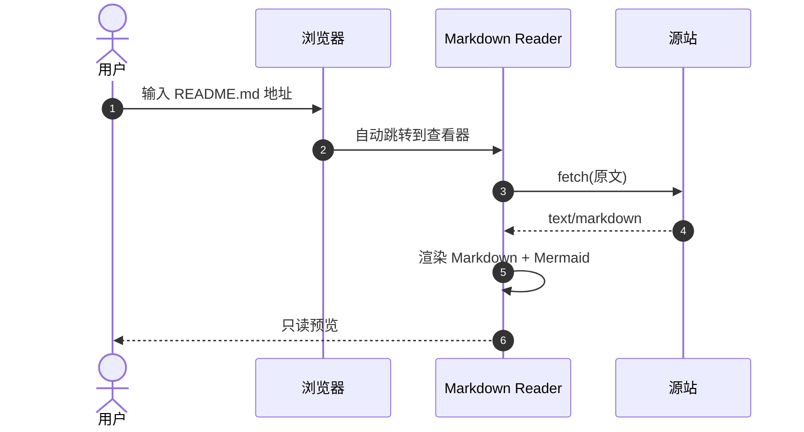

# Ry Markdown Reader 预览样例

这是一个只读的 **Markdown** 预览页面。中文使用 MiSans Medium，英文与代码使用 JetBrains Mono。

> 地址栏输入 `.md` 链接会自动打开这里；当前页面也可以用来检查排版、表格、任务列表与 Mermaid。

## 基础排版

普通段落里可以有 `inline code`、[链接](https://example.com)、**加粗**、*斜体*、~~删除线~~，以及键盘按键 <kbd>Ctrl</kbd> + <kbd>K</kbd>。

- 无序列表
- 第二项
  - 嵌套项
  - 另一个嵌套项
- 第三项

1. 有序列表
2. 第二步
3. 第三步

- [x] 已完成的任务
- [ ] 未完成的任务
- [ ] 另一个待办

### 引用

> 配色参考 Sapgir：品牌蓝 `#4D6BFE`，浅色与深色两套 token。
>
> 这是引用的第二段。

### 表格

| 功能 | 状态 | 说明 |
| --- | :---: | --- |
| Markdown 渲染 | 完成 | marked + DOMPurify |
| 代码高亮 | 完成 | highlight.js |
| Mermaid | 完成 | 支持 flowchart / sequence / gantt |
| 明暗主题 | 完成 | 右上角切换，自动保存 |

---

## 代码高亮

```js
import { createReader } from './reader.js';

const reader = createReader({
  theme: 'light',
  readonly: true,
  mermaid: true,
});

await reader.open('https://example.com/README.md');
console.log('Rendered in', reader.elapsed, 'ms');
```

```python
from dataclasses import dataclass

@dataclass
class Document:
    title: str
    source: str
    readonly: bool = True

    def summary(self) -> str:
        return f"{self.title} — {len(self.source)} chars"
```

```bash
# 本地预览
python3 -m http.server 8080
open http://localhost:8080/viewer.html?src=/test/sample.md
```

```json
{
  "name": "ry-md-reader",
  "version": "1.0.0",
  "features": ["markdown", "mermaid", "light/dark"],
  "readonly": true
}
```

## Mermaid

### 流程图


### 时序图



### 甘特图


## 图片

相对路径图片会根据 Markdown 地址解析：


## 长内容测试

Lorem ipsum dolor sit amet, consectetur adipiscing elit. Integer posuere erat a ante venenatis dapibus posuere velit aliquet. Cras mattis consectetur purus sit amet fermentum. Donec ullamcorper nulla non metus auctor fringilla.

中文段落用于检查 MiSans Medium 的字重与行高。字体回退顺序为 JetBrains Mono → MiSans → 系统等宽字体：英文与数字由 JetBrains Mono 渲染，中文由 MiSans 渲染。

```text
纯文本代码块
第二行：The quick brown fox jumps over the lazy dog.
第三行：0123456789
```

---

<p align="right"><sub>只读预览 · Ry Markdown Reader</sub></p>
